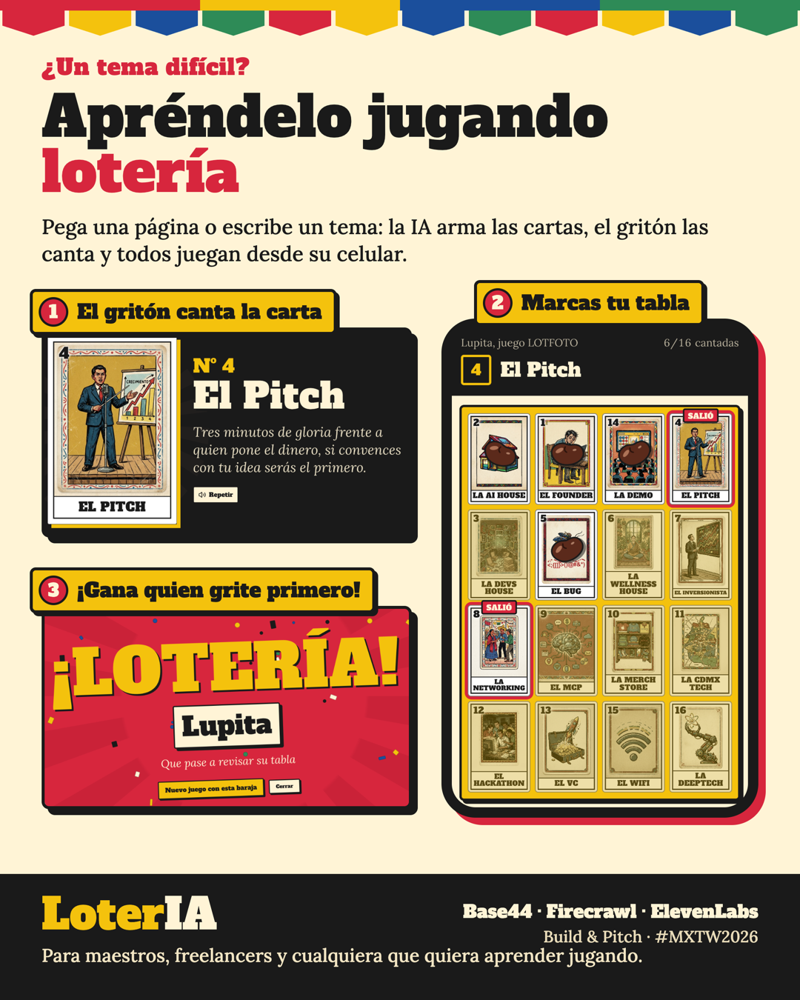
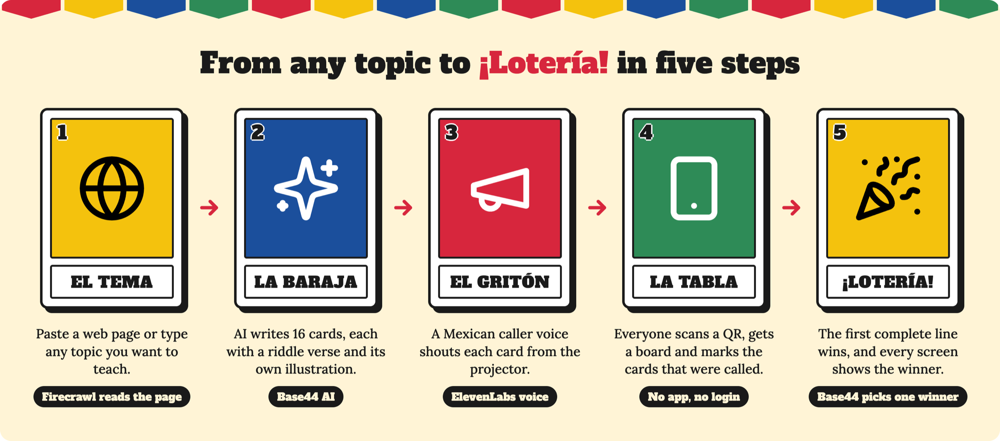
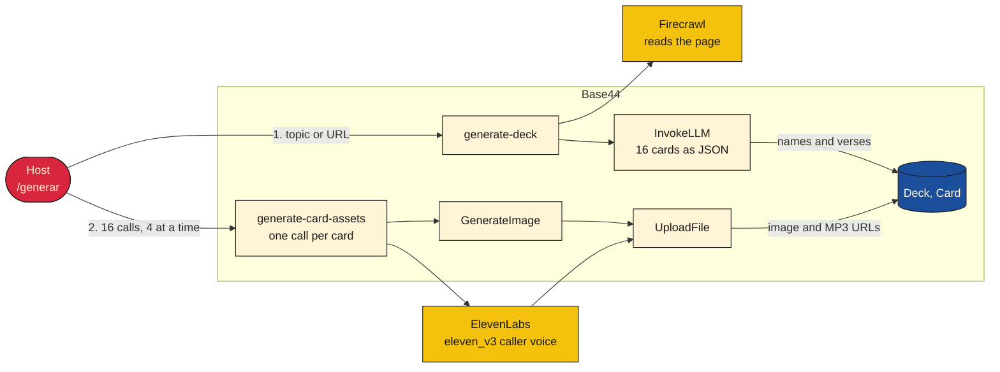
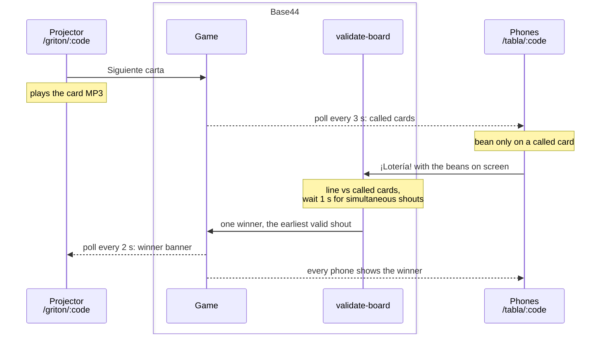

# LoterIA

Turn any topic into a Mexican lotería and learn it by playing. Paste a web page or type a topic: AI writes the cards, a Mexican caller voice shouts them from the projector, and the room plays from their phones.

[](https://github.com/frogzdany/loteria-ia/actions/workflows/ci.yml)


**Live demo:** https://loteria-tech-week-5cbc9957.base44.app

Built for the Build & Pitch competition at Mexico Tech Week 2026 with three partner integrations:

| Partner | Role in the app |
|---|---|
| [Base44](https://base44.com) | Hosting, entities (Deck, Card, Game, Board), Deno backend functions, secrets, `InvokeLLM`, `GenerateImage` and `UploadFile` |
| [Firecrawl](https://firecrawl.dev) | Reads the source page (`/v2/scrape`) and turns it into markdown for the card prompt |
| [ElevenLabs](https://elevenlabs.io) | `eleven_v3` text to speech with audio tags (`[shouts]`) for the caller voice of every card |



## What it does

- The host pastes a theme or a page URL on `/generar`.
- Firecrawl turns the page into markdown. An LLM writes 16 cards, each with a name and a two-line verse in the style of a Mexican caller (gritón).
- Each card gets an image (Base44 `GenerateImage`) and a voiced MP3 of its verse (ElevenLabs `eleven_v3`).
- The host opens `/griton/:code` on a projector, calls cards one by one, and the audio plays.
- The audience scans a QR code, opens `/tabla/:code`, gets a shuffled 4x4 board and taps cells to mark them.
- A player who completes a row, column, diagonal or the four corners presses "¡Lotería!". The backend validates the board and the projector shows the winner.

The app runs on Base44 (entities, hosting, backend functions). Game codes look like `MTWK4P`.

### Game rules

- The first player to press "¡Lotería!" with a complete line of called cards wins: a row, a column, a diagonal or the four corners.
- Beans only go on cards that were already called. The phone rejects the rest with "Esa carta todavía no sale". Called cards without a bean show a red frame and a "SALIÓ" tag; cards not called yet are dimmed.
- Winning is not automatic: the player has to shout, as in the traditional game.
- When two players press at almost the same moment, the earliest valid shout wins. The other sees "Línea válida, pero ya ganó …". A winner is never replaced once announced.
- Every phone shows the winner. When the host opens "Nuevo juego con esta baraja", the phones offer "Jugar el siguiente juego" without scanning again.

## Quick start

Requires Node 22 and a Base44 account with the secrets listed in `.env.example`.

```bash
npm install
npx base44 login
npx base44 secrets set --env-file .env
npx base44 deploy --build -y
```

Then open `<your-app-url>/generar`, paste the agenda URL, press "Generar baraja", and when the deck is ready press "Crear juego".

Verified end to end on the deployed app: a deck generated from the real agenda, a game created from it, a phone board that joined by code, 12 cards called from the projector, a row marked and "¡Lotería!" pressed. The projector showed the winner banner. During that run the Base44 integration credits ran out, so the final validation happened on the phone (see Limits).

Run the tests (no network, no keys):

```bash
npm test
```

Current run: `Tests 128 passed (128)`.

### Local development with zero credits

```bash
npx base44 dev          # local backend on :4400 with its own in-memory database, Vite on :5173
npm run seed:local      # copies the demo deck from the deployed app into the local database
```

Base44 blocks `InvokeLLM` and `GenerateImage` from the local dev runtime, so on localhost the functions switch to a deterministic mock provider: 24 fixed cards, SVG placeholders and a 0.5 s WAV beep per verse. It needs no key and no network, and the whole flow (generate, fill assets, create a game, play, win) runs offline. `seed:local` adds the real deck (names, verses, images and MP3s served from their public URLs) so the UI can be polished with real content. The local database is empty on every start, so run the seed again after a restart. `LOTERIA_PROVIDER=base44|mock` overrides the choice; local dev reads it from `.env.local` or `.env` (the CLI loads both with dotenv). The override was not exercised in the verification below; the automatic loopback detection was.

Verified on localhost: `generate-deck` with the mock wrote 16 cards in 29 ms, `generate-card-assets` filled a card in 18 ms, and the seed copied the 16 real cards and opened a lobby game.

### Real images and text from OpenAI

Add `OPENAI_API_KEY` to `.env`. On localhost the functions then pick the `openai` provider by themselves: card texts from `gpt-4.1-mini` with structured output, images from `gpt-image-1` (portrait 1024x1536, quality `low` by default, stored with `UploadFile`), and the voice from ElevenLabs when configured, otherwise `gpt-4o-mini-tts`. `gpt-image-1` needs a verified OpenAI organization; when the API answers that the model does not exist, the provider falls back to `gpt-image-1-mini` and then `dall-e-3` on its own. Set `OPENAI_IMAGE_QUALITY=medium` or `high` for the real deck, and `OPENAI_IMAGE_MODEL`, `OPENAI_TEXT_MODEL` or `OPENAI_TTS_VOICE` to change models. `LOTERIA_PROVIDER=mock` brings the offline mock back.

Measured on localhost with the real agenda, 4 cards: `generate-deck` 4 s (scrape 0.7 s, `gpt-4.1-mini` 3.1 s, 3,030 tokens in and 177 out); per card 8 to 12 s, of which `gpt-image-1-mini` at `low` took 7.6 to 10.1 s (408 output tokens, 240 to 272 KB JPEG) in parallel with ElevenLabs at 2.5 to 2.9 s. This account had no access to `gpt-image-1`, so every image came from the first fallback.

In production the default stays `base44`. Push the key with `npx base44 secrets set --env-file .env` and set `LOTERIA_PROVIDER=openai` to switch; a deck then costs Base44 only the 17 `UploadFile` calls instead of about 35 integration calls, and the OpenAI usage is billed to your OpenAI account.

## How it works



<details>
<summary><b>Under the hood</b>: how the screens, the Base44 functions and the partners talk to each other</summary>

**1. Build a deck** (about 30 s for 16 cards)



**2. Play** (the projector and every phone poll the same Game)



</details>

The pure logic (winning lines, shuffling, dealing boards, game codes, prompts, normalization of LLM output) lives in `base44/shared/loteria.js`. It has no imports and no I/O. The backend functions, the React frontend and the vitest suite import the same file. The three AI steps (card texts, image, speech) go through `base44/shared/providers.ts`, which picks `base44`, `openai` (request builders and parsers in `base44/shared/openai.js`) or the offline `mock` from `base44/shared/mock.js`.

Backend functions read secrets with `secrets.get` from `base44:runtime`. A fourth function, `speak-card`, synthesizes a verse live as a backup if pre-generated audio is missing.

## Design choices

| Choice | Why |
|---|---|
| Pre-generated audio, not live TTS | Eleven v3 has variable latency and is not meant for real time. Audio is generated before the event and stored on the Card, so calling a card is a file download. `speak-card` exists only as a backup. |
| One `generate-card-assets` call per card, driven by the browser with a pool of 4 | One function that does 16 images and 16 syntheses can hit the function time limit and loses everything on failure. Per-card calls are short, retryable one by one ("Reintentar" button, `force: true`), and give a real progress bar. |
| Polling (2 s and 3 s) instead of websockets or actors | A lotería has one call every few seconds and a few dozen players. Polling Game and Board is simple to reason about and to debug. Real-time actors would add moving parts for no visible gain at this scale. |
| Card name and number drawn with CSS over the image | Image models misspell text. The images are prompted with "no text, no letters, no numbers" and the 16 cards stay visually consistent. |
| Anonymous access with RLS `create/read/update: true` | Players join from a QR with no login. Friction at the door costs more than the risk in a demo. See Limits. |
| One pure module shared by Deno, Vite and vitest | The win rule is the part that must not be wrong, and it runs in the browser (pre-check) and the backend (authority). One file means one definition, and it can be tested offline in milliseconds. |
| One winner, decided by the traditional rule | The first valid shout wins, and a winner is never replaced. Base44 entities have no transactions, so `validate-board` stamps the claim with the server time, waits 1 s for simultaneous claims, picks the earliest one (board id breaks an exact tie) and re-reads before answering. Every caller computes the same winner. The rules live in `base44/shared/game.js`; the phone runs the same function against the entities when the backend is down. |
| The screen never goes backwards | Polls go through `mergeGame`: a slow answer cannot drop a called card, unset the winner or move the status back. "Siguiente carta" re-reads the game first, writes only the called list and stops once there is a winner. Beans are saved one write at a time with the newest value last, and a claim sends the beans on screen, so a slow write cannot hide a winning line. |
| Verse does not say the card name | The verse is the riddle and the name is shouted at the end, as in the traditional game. This is enforced in the prompt, not in code. |
| Provider switch per request: `base44`, `openai` or `mock` | Base44 blocks InvokeLLM and GenerateImage from the local dev runtime, and the free plan ran out of credits on the first real deck. The three AI steps sit behind one interface. `mock` (24 fixed cards, SVG placeholders, WAV beeps) keeps the flow runnable offline. `openai` uses your own key and only needs Base44 for file storage. On loopback hosts the choice is `openai` with a key, else `mock`; elsewhere `base44`. The `LOTERIA_PROVIDER` secret overrides, and an unknown value falls back to `base44`, so a typo cannot change production. |

## Limits

- CI covers the pure modules only: `base44/shared/loteria.js` (rules, prompts, normalization), `base44/shared/mock.js` (mock provider) and `base44/shared/openai.js` (OpenAI request builders and parsers), `base44/shared/game.js` (claims, winner, sync merge, next call) and the bean writer, 128 tests. The claim tests run 60 rounds of 4 winners and 3 losers pressing at once against an in-memory database with random delays and check that each round ends with exactly one winner, the earliest shout, and that everyone is told the same name. A control test runs the previous algorithm in the same setup and shows it crowned two winners. The backend functions run offline through `npx base44 dev` with the mock provider, but that is a manual step, not part of CI. The real integrations (InvokeLLM, GenerateImage, OpenAI, ElevenLabs, Firecrawl, UploadFile) are not exercised in CI.
- The `openai` provider calls `gpt-image-1` four at a time (the browser pool). A new OpenAI account has a low images-per-minute limit, so some calls can return 429; the provider retries twice with backoff and the page offers "Reintentar" and "Completar faltantes" for the rest. Image quality `low` keeps a test deck cheap; check OpenAI's pricing page before generating at `high`.
- The mock provider stores its WAV beeps with `UploadFile`. On the local dev server that is a local file; in production it would cost 1 credit per file, so `LOTERIA_PROVIDER=mock` is meant for local use.
- CI runs `npx vite build`. That build works without a Base44 app id and prints a warning that `VITE_BASE44_APP_ID` is not set. The output compiles but would not reach any backend. Deployment goes through `npx base44 deploy --build -y`.
- Cost per deck: 16 image generations, about 2,400 ElevenLabs characters, 1 Firecrawl credit and 1 InvokeLLM call. Image generation is the largest consumer of Base44 credits.
  Measured: one 16-card deck makes 1 `InvokeLLM`, 16 `GenerateImage` and 17 `UploadFile` calls (34 integration calls). The free workspace plan hit its monthly integration limit during the first real deck, after the backend tests had used about 15 calls. From then on every backend function returned HTTP 402 (`integration_credits_limit_reached`), including `validate-board`, which uses no integration. Entity reads and writes kept working. Check the plan before the event.
- ElevenLabs Starter allows 3 concurrent requests and the generator runs 4 cards at a time. The functions retry a 429 with backoff and never switch to another voice because of it, so every card keeps the same Mexican caller. The voice is `ELEVENLABS_VOICE_ID`, the consistency knob is `ELEVENLABS_STABILITY` (default 0.5).
- ElevenLabs free tier gives 10,000 characters per month, which covers about 4 decks. Using `eleven_v3` through the API depends on your plan.
  Measured: the generated deck sent about 1,950 characters to ElevenLabs (16 verses with tag and name, 95 to 140 characters each) plus 35 for the "¡Lotería!" shout.
- Generation time depends on the image and TTS services.
  Measured on the real agenda URL: the 16 card texts existed 6 s after the deck was created (Firecrawl scrape 0.7 s, LLM about 4 s). 15 of 16 cards had image and audio 31 s after creation. The 16th card lost its audio when `UploadFile` failed once; the function now retries the upload three times.
  Measured: 7 to 10 s per card (image and audio in parallel, ElevenLabs about 2.5 s of that). With a pool of 4 the deck finishes in about 4 rounds.
  Measured: 121 KB per card MP3 on average (103 to 132 KB, 128 kbps mono), 48 KB for the shout.
- When backend functions are unavailable (HTTP 402), the board validates on the phone with the same rule and writes `Board.valid` and `Game.winner_*` directly. That path has no server authority: a modified client could declare itself the winner. The host confirms the board by eye, as in the traditional game.
- The Base44 hosting badge ("Made with Base44") is injected at the bottom right of every page. On phones it covered the "¡Lotería!" button, so the bottom bar reserves 64 px for it.
- Ties are common by design. Every board holds the same 16 cards in a different order, so with 30 players about 4 in 10 games have two or more boards completing a line on the same card (simulated, 8,000 games), and the median game ends on card 5. The app names one winner, the first to shout. A 24-card deck would push the median to card 7 and the ties to about 3 in 10, at 8 more images per deck.
- The claim takes 1.3 s locally (10 rounds of 6 simultaneous claims, one winner every round) and about 3 s in production. That is the settle window, not slowness. The guarantee holds unless a board write takes longer than that window to become visible, which Base44 does not rule out because it has no conditional writes.
- Anonymous write access means anyone who knows or guesses a game code can edit that game or any board, including calling cards or marking another player's board. Delete is disabled. There is no authentication. The phone only lets a player mark called cards and `validate-board` re-checks the line against the called cards on the server, but a modified client could still write to the entities directly.
- Anyone who opens `/generar` can start a deck generation and spend credits. A public deployment needs authentication or rate limits on that page.
- Polling creates load proportional to players and screens. It has not been tested beyond a handful of phones.
- Demo-grade. No rate limiting, no cleanup of old decks or games, no moderation of LLM output beyond the prompt rules.

## Security

- The ElevenLabs, Firecrawl and OpenAI keys live in Base44 secrets (or in `.env` for local dev) and are read only inside backend functions. They never reach the browser.
- `.env` is gitignored. Only `.env.example` with variable names is committed.
- The page content fetched by Firecrawl is untrusted input to the LLM prompt. `cleanContext` strips images, links and URLs and caps the text at 12,000 characters. It does not defend against prompt injection, and the worst result is a deck with odd cards.
- Entity RLS is open on purpose (see Limits). Do not store personal data in `player_name`.

## Roadmap

- Decks of 20 cards with 16 per board, so boards differ (`dealBoard` already supports it).
- Public free-theme mode where anyone generates their own lotería, with rate limits.
- A shared bank of decks by subject and grade, for teachers.
- Review mode: after the game, each card becomes a study card with its verse.
- Verses in other languages, for vocabulary practice.
- More table games on the same engine (memorama, basta).

## License

MIT. See `LICENSE`. Copyright 2026 Daniel Fragoso.

## Resumen en español

LoterIA convierte cualquier tema en una lotería mexicana para aprenderlo jugando. Firecrawl lee la página, un LLM escribe 16 cartas con verso de gritón, Base44 ilustra cada carta y ElevenLabs les pone voz. El anfitrión canta las cartas desde un proyector y el público juega desde el celular tras escanear un QR; el backend valida filas, columnas, diagonales y esquinas, y aunque varios griten a la vez gana uno solo. La lógica pura, el proveedor mock y los armadores de peticiones a OpenAI están en módulos compartidos con 128 pruebas de vitest, incluida una que simula a varios jugadores gritando lotería al mismo tiempo, que corren sin red ni llaves. En local (`npx base44 dev`) las funciones usan OpenAI si hay `OPENAI_API_KEY` y si no el proveedor mock, así que todo el flujo corre sin créditos de Base44, y `npm run seed:local` copia la baraja real para pulir la interfaz. Las integraciones reales no se prueban en CI y el acceso es anónimo, así que es una demo y no un producto. Los tiempos y créditos por baraja son los medidos en la primera corrida real.
